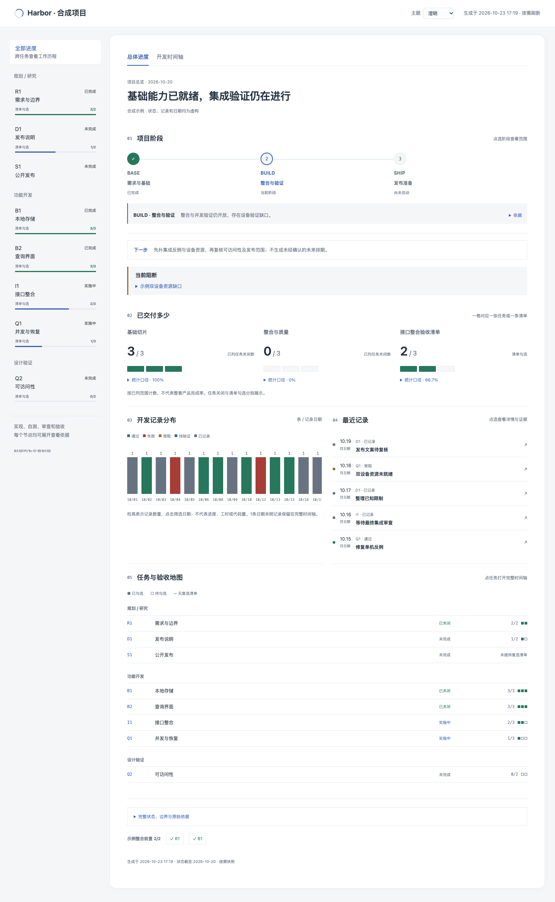
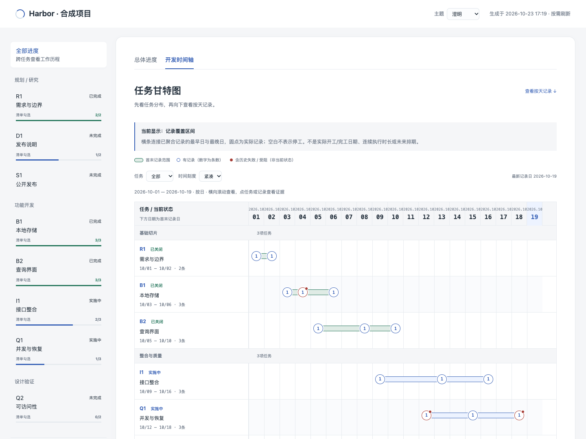
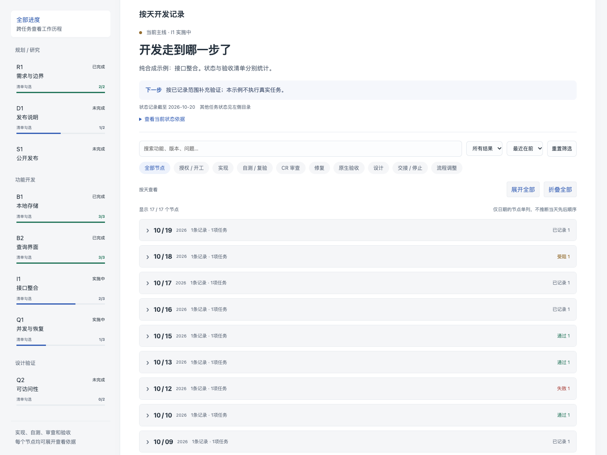

# Project Progress Timeline

把 Markdown 任务和验收记录，变成**能追溯证据的项目进度看板**。

[English](README.en.md) · [数据格式](references/schema.md) · [贡献指南](CONTRIBUTING.md) · [MIT](LICENSE)

适用于 Codex 的本地 Skill，也能直接作为 Python 静态页面生成器使用。运行时仅使用 Python 标准库，无需前端构建或 API 密钥。默认界面为中文。



## 能看什么

- **总体进度**：阶段路线、分组任务格、正式验收清单矩阵、记录分布和最近记录。
- **开发时间轴**：上方甘特图展示各任务的记录覆盖区间，下方记录按天折叠，支持全部展开/折叠。
- **可追溯证据**：每个节点关联 Markdown 唯一行锚点及 SHA-256。任务状态或引用行变化时，生成器拒绝沿用旧摘要。
- **三套主题**：澄明、夜航、日记；保留主题选择，支持搜索、任务/阶段/结果筛选与时间排序。





截图及 `examples/demo/` 全部使用虚构项目数据，不代表真实产品的交付情况。

## 安装为 Codex Skill

需要 Git 和 Python 3.10+（包括 IANA 时区数据）。在**实际执行 Codex 的主机**上运行：

```bash
git clone https://github.com/sunhuaian2026/project-progress-timeline.git \
  "$HOME/.codex/skills/project-progress-timeline"
```

如果设置了 `CODEX_HOME`，改用 `$CODEX_HOME/skills/project-progress-timeline`。已有同名目录时，先备份并比较本地定制，不直接覆盖。也可从 [Releases](https://github.com/sunhuaian2026/project-progress-timeline/releases) 下载 ZIP，解压后将 `project-progress-timeline` 文件夹放入对应 `skills` 目录。

在新会话中调用：

```text
使用 $project-progress-timeline，核对本项目的任务和验收证据，刷新项目进度表。
```

Skill 会指导 agent 核实事实，再维护项目自己的 `progress/timeline.json` 与可选 `progress/overview.json`。**它不会自行读取 Git 历史就断定完成，也不是后台任务管理器。** 其他 agent 宿主可读取 `SKILL.md`；其发现和调用机制需分别验证。

## 两分钟运行示例

在仓库根目录运行：

```bash
python3 scripts/render.py \
  --project examples/demo \
  --data examples/demo/progress/timeline.json \
  --output examples/demo/site

python3 -m http.server 8080 --bind 127.0.0.1 --directory examples/demo/site
```

浏览器打开 [示例看板](http://127.0.0.1:8080/)。这个示例命令仅供本机预览；需要局域网访问时，按自己的项目规则选择监听地址。

查看变化候选而不生成页面：

```bash
python3 scripts/render.py \
  --project examples/demo \
  --data examples/demo/progress/timeline.json \
  --output examples/demo/site --inventory-only
```

示例 JSON 的哈希绑定 Markdown 原文。修改来源后若生成失败，应先复核事实，再更新摘要及对应行哈希；不要只为通过校验重写哈希。完整字段和计算方式见[数据约定](references/schema.md)。

## 接入自己的项目

1. 用本地 Markdown 维护任务，包含 `State: open`、`in-progress` 或 `done`。
2. 参考 `examples/demo/` 建立项目的任务、事件、唯一行引用和行哈希。
3. 用可选 `overview.json` 配置阶段、分组、前置门槛和阻断项。未提供时使用通用总体视图。
4. 执行渲染器。输出目录必须位于项目内，末级目录名为 `site`。
5. 只服务这个 `site` 目录，核对浏览器中的状态、筛选和证据。

可以将脚本安装在一个位置，为多个独立项目生成页面；项目的实际状态、编号和数据保存在各自项目内。

## 统计边界

| 展示 | 实际含义 |
|---|---|
| 分组完成数 | 已列任务中 `done` 的数量，不是整个产品工作量百分比 |
| 清单格 | 正式复选清单的勾选状态；表格 AC 不自动转换为已勾选 |
| 甘特横条 | 已聚合记录的最早日至最晚日，不是实际开工/完工、连续工时或未来计划 |
| 柱状图 | 按记录日期聚合的节点数，不是生产力或代码量 |
| 未知日期 | 保留在列表中，不补造时刻或横条 |

记录跨度超过120天时，甘特图按7日分组并标注。该版本不提供计划/实际对照、依赖箭头、关键路径、工时估算或团队权限管理。页面重新加载只读取已生成快照，不自动刷新任务数据。

## 隐私与发布

生成的 HTML 和证据页包含**被引用 Markdown 文件的完整内容**，不只是引用的那一行。目录名称、任务摘要和未引用候选路径也可能出现在页面中。

因此，发布看板前必须检查整个输出目录及全部引用文件；唯一行哈希校验不等于脱敏。生成器不验证附件是否敏感，也不会替你授予发布授权。运行时没有遥测或自动上传；绑定局域网/公网 HTTP 服务后，访问范围由你的服务配置决定。

生成时间和默认“北京时间”说明使用 `Asia/Shanghai`。其他时区的展示需自行适配并验证。网页为静态 HTML，依赖 JavaScript；支持现代浏览器。实际浏览器检查使用 Chromium，其他浏览器和完整读屏体验仍需分别验收。

## 开发与验证

```bash
python3 -m unittest discover -s tests -v
```

测试覆盖示例生成、状态与证据漂移、时间精度、路径越界和未知清单等行为。CI 在 Linux 上运行 Python 3.10 / 3.12 / 3.14。源码还经本地 Chromium 检查主题、筛选、甘特定位和按天开合；这不等于完整浏览器兼容认证。

## 目录

```text
SKILL.md                  agent 使用入口
scripts/                  标准库渲染与总体状态计算
assets/                   自包含 HTML / CSS / JavaScript / 三主题
references/schema.md      数据格式与计算边界
agents/openai.yaml        Codex 界面元数据
examples/demo/            纯合成项目与完整输入
tests/                    生成与校验回归测试
```

按需生成、保留原始证据、把未知留作未知。
